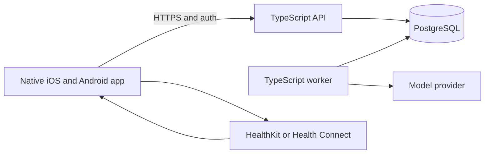

# Backend architecture

## Product boundary

This is a consumer fitness and wellness app. People record meals, strength workouts, runs and walks, water, and supplements. The native app may import sleep and activity from Apple HealthKit or Android Health Connect after the person grants access. The backend stores the person's record, builds daily views, and offers explainable suggestions. It does not diagnose conditions, prescribe supplements, or silently change a goal.

The first release should support one person's private account and one mobile app on each platform. A coach, social network, clinician portal, and multi-tenant organizations are outside this design. These are product assumptions, not technical constraints.

## Caller's view

The native client calls a versioned HTTPS JSON API. Each mutation has a client-generated idempotency key so offline retries are safe. The API returns the stored record and its revision. For example:

```http
POST /v1/food-entries
Idempotency-Key: 8f45...
{ "occurredAt": "2026-09-24T12:30:00Z", "timeZone": "Europe/Lisbon", "food": { "name": "Oats", "quantity": { "amount": 80, "unit": "g" }, "nutrients": { "kcal": 311, "proteinG": 13, "carbsG": 53, "fatG": 5 } } }

POST /v1/wearable-imports
Idempotency-Key: b061...
{ "changes": [{ "operation": "upsert", "source": { "kind": "wearable", "provider": "healthkit", "externalId": "sample-123" }, "sourceRevision": "sample-fingerprint", "timeZone": "Europe/Lisbon", "value": { "kind": "sleep", "data": { "startedAt": "2026-09-23T23:00:00Z", "endedAt": "2026-09-24T07:00:00Z" } } }] }

GET /v1/days/2026-09-24
GET /v1/foods/search?q=oats&locale=pt-PT
GET /v1/foods/barcodes/5601234567890
GET /v1/suggestions?date=2026-09-24
POST /v1/suggestions/{id}/responses
{ "response": "accepted" }
```

The client owns HealthKit and Health Connect permissions, change cursors, and platform queries. It uploads normalized changes. The server owns deduplication, record history, user authorization, and downstream suggestions. Both platforms expose changes and deletions through their native sync APIs. [HealthKit anchored queries](https://developer.apple.com/documentation/healthkit/hkanchoredobjectquery) and [Health Connect change tokens](https://developer.android.com/health-and-fitness/health-connect/sync-data) inform this contract.

## System shape



Use one repository and one database. The API and worker are separate processes built from the same domain modules. Start with Node.js 24 LTS, TypeScript in strict mode, Hono with `@hono/zod-openapi` for HTTP contracts, Zod at external boundaries, Drizzle for typed SQL and reviewed SQL migrations, and Oxlint with type-aware rules plus `tsc --noEmit`. Node 24 is LTS as of September 2026; Node 26 is still Current. [Node release schedule](https://nodejs.org/en/about/previous-releases). Hono supports Node and OpenAPI generation. [Hono Node adapter](https://hono.dev/docs/getting-started/nodejs), [Hono Zod OpenAPI](https://hono.dev/examples/zod-openapi). Drizzle generates migration SQL, and Oxlint's type-aware mode uses `oxlint-tsgolint`. [Drizzle migrations](https://orm.drizzle.team/docs/migrations), [Oxlint type-aware linting](https://oxc.rs/docs/guide/usage/linter/type-aware).

The repository now vendors [anti-slop](../tools/oxlint/anti-slop/UPSTREAM.md) as an Oxlint plugin and enables all its generic rules. Its Effect-specific rules stay disabled because the design does not use Effect. The lint packages are pinned to matching versions. `pnpm lint` and `pnpm typecheck` run now. The implementation should add a test command and `db:migrate: drizzle-kit migrate`. Keep generated OpenAPI checked in or published from CI so native clients can generate types. No agent framework, vector database, Kafka, or Redis is required for the first release.

## Module map

| Module | Owns | Public operation |
| --- | --- | --- |
| `identity` | User identity, consent, account deletion | `requireActor`, `deleteAccount` |
| `journal` | Manual food, water, supplement, strength, and cardio entries; edits | `record`, `revise`, `remove` |
| `foods` | Search, barcode lookup, source attribution, nutrient normalization | `search`, `findByBarcode` |
| `wearables` | Imported sleep and cardio, source mapping, revisions, deletion | `applyChanges` |
| `days` | Local-day totals and evidence quality | `getDay`, `buildEvidence` |
| `coaching` | Eligibility rules, model adapter, output checks, suggestion history | `generate`, `getSuggestions`, `respond` |
| `platform` | HTTP, database transaction and job adapters | No domain API |

These modules own full operations. They do not split into generic controller, service, repository, validator, and mapper layers. HTTP and SQL types stop at adapters. Domain code receives parsed inputs and returns domain results.

## Core types and signatures

The following is a design sketch. It is the contract to implement, not runnable code.

Each feature's `contract.ts` under `src/` defines its data shapes with Zod. The runnable manual-food slice has its own [design rationale](food-slice-design.md) and exposes the food routes above.

The public interface hides source deduplication, revisions, SQL, model prompts, and job scheduling. Callers provide a domain command and receive a stored result. Branded identifiers and discriminated unions prevent mixing users, entries, and record kinds. Zod validates JSON and converts strings into these types at the HTTP boundary. Database constraints repeat the critical ownership and uniqueness checks.

## Persistence and invariants

Use domain tables for current records: `food_entries`, `water_entries`, `supplement_entries`, `strength_workouts`, `strength_sets`, `cardio_sessions`, and `sleep_sessions` with optional `sleep_stages`. Every row has `user_id`, `source`, `occurred_at`, `time_zone`, `created_at`, `updated_at`, and `revision`. Store a nutrient snapshot and catalog source on each food entry. A later catalog edit must not rewrite historical totals. Store quantities in fixed units and nutrients as decimals. A missing nutrient is `null`, never zero.

### Food data

Start with [USDA FoodData Central](https://fdc.nal.usda.gov/api-guide/) for generic ingredients. It has a documented API, public-domain CC0 data, and a default limit of 1,000 requests per hour per IP. It is US-centered, so its branded products are a poor primary match for Portuguese shopping. For a Portugal launch, evaluate [PortFIR's Portuguese food composition table](https://portfir.insa.min-saude.pt/pt/) for local generic foods. PortFIR offers an Excel download and its 2026 table contains 1,376 foods, but the site does not make commercial reuse terms clear. Confirm those terms with INSA before importing it into the product. [PortFIR 2026 update](https://portfir.insa.min-saude.pt/pt/2026/05/13/atualizacao-da-tabela-da-composicao-de-alimentos-2/).

Use [Open Food Facts](https://openfoodfacts.github.io/documentation/docs/Product-Opener/api/) for packaged foods found by barcode if the product accepts its ODbL attribution and share-alike obligations. Its data is community-entered and can be incomplete or wrong. Its own guidance recommends national composition databases for foods without barcodes. [Open Food Facts on non-barcode foods](https://support.openfoodfacts.org/help/en-gb/12-api-data-reuse/62-what-about-food-without-barcodes). Keep provider records and license provenance separate; do not silently blend catalogs into one redistributable database. Separation alone does not establish license compliance, so review the intended product use before launch. If the business needs a closed combined catalog, choose a licensed commercial barcode provider instead of importing Open Food Facts. People can always create or correct a food manually.

Normalize provider nutrients to energy, protein, carbohydrate, and fat per 100 g or 100 ml with explicit units and a `missing` state. Search results show source and whether values are complete. Logging scales those values by the measured portion and freezes the result. A daily total is `null` or marked incomplete if any logged item lacks that nutrient. User corrections create a personal food version, not a silent edit to the provider record. Do not have the model invent missing macros.

Use `users`, `goals`, and `consents` for account state. Use `source_records` to map `(user_id, provider, external_id)` to a current internal record, source revision, and deleted state. This unique key makes repeated device uploads harmless. A source revision is an opaque value supplied by the native adapter, such as a platform modification timestamp or a stable fingerprint when the platform has no revision field. Keep `entry_revisions` for changes to records that affect recommendations. Keep the revision payload minimal and purge it when the account is deleted. `idempotency_keys` stores a request hash and result for bounded retry retention; reusing a key with a different body is an error. All reads and writes scope by authenticated `user_id`.

`suggestion_runs` stores the evidence snapshot hash, model and prompt versions, policy version, generated time, and status. `suggestions` stores the message, evidence references, and response. A changed source record invalidates affected suggestions. A `jobs` table holds generation requests and retry state. The transaction that changes a record also inserts a job. The worker claims due jobs with a database lease and retries safely. Begin without a separate queue service.

`occurred_at` is UTC. Preserve the IANA time zone reported at recording time. Group food and activity by the local date at occurrence. Attribute a sleep session to the local date on which it ends. Recompute both affected dates if an edit crosses midnight or changes time zone. The API must distinguish zero recorded from missing data. A day with no food entries is unknown intake, not zero calories consumed.

## Coaching flow

1. Build an immutable, versioned `DayEvidence` snapshot from current records and recent history. Include source quality, missing data, and each contributing record revision.
2. Apply deterministic eligibility and safety rules. Missing or stale sleep blocks recovery claims. Sparse food logs block calorie-change proposals. Do not infer exercise calories as precise intake credits.
3. Let a model rank and phrase allowed suggestions using only the bounded snapshot. Validate its structured output against an allowlist and numeric limits. The model cannot call mutation tools.
4. Save the suggestion with its evidence and versions. Show uncertainty and why the suggestion was made. A goal change remains a proposal until the person explicitly accepts it.
5. When evidence changes, mark linked suggestions stale and regenerate. If generation fails, the journal and day view keep working.

The exact nutrition and exercise thresholds are product and clinical policy decisions. Do not bury them in a prompt. Start with modest, reversible suggestions such as rest after a hard training day with poor sleep, or hydration reminders based on recorded intake. Evaluation needs fixture timelines with late wearable updates, missing days, conflicting sources, and unsafe proposals. Review the resulting suggestions before release.

## Privacy and operations

Treat food, exercise, and sleep as sensitive personal data. Ask separately for wearable access and AI processing, and record consent state and revocation. Apple requires fine-grained HealthKit authorization. [Apple HealthKit authorization](https://developer.apple.com/documentation/healthkit/authorizing-access-to-health-data). For an EU launch, health data can be a special category, and access, erasure, and portability requests need product support. [European Commission on legal grounds](https://commission.europa.eu/law/law-topic/data-protection/information-business-and-organisations/legal-grounds-processing-data_en), [European Commission on individual requests](https://commission.europa.eu/law/law-topic/data-protection/information-business-and-organisations/dealing-requests-individuals_en). Get jurisdiction-specific legal review before launch.

Use managed identity with short-lived bearer tokens, TLS, encryption at rest, separate production credentials, and no raw health payloads in application logs or traces. Restrict model input to the evidence needed for a suggestion and make provider retention and model training terms an explicit vendor choice. Account deletion must remove records, revision history, suggestions, integration keys, and jobs. Document backup expiry and recovery. Observe sync failures, worker lag, and suggestion rejection rates without logging private payloads.

## Build order

1. Set up the TypeScript workspace, Oxlint, type checking, API shell, Postgres migrations, authentication boundary, and a local integration test database.
2. Implement manual food and water logging, USDA-backed generic search, edits, idempotency, and a day view. This proves the nutrient, record, and time-zone models.
3. Add strength, cardio, and supplements through the same journal contract, with domain-specific tables and validation.
4. Add native HealthKit and Health Connect adapters, then the wearable import protocol with duplicates, revisions, deletions, and expired cursor recovery.
5. Add deterministic suggestion rules and evidence trails. Introduce the model only after fixture evaluations cover unsafe and missing-data cases.
6. Add export, deletion, consent revocation, operational dashboards, and launch review.

## Decisions still needed

- Which platform launches first, and which wearable metrics beyond sleep and cardio matter at launch?
- Is Portugal the first food market, and can PortFIR reuse terms be confirmed? Will the product accept Open Food Facts share-alike terms or use a commercial barcode catalog?
- Will calorie targets be entered by the person, reviewed by a qualified professional, or proposed by the app? This determines the policy gate for `goal-change`.
- Which regions will hold user data, and may the selected model provider retain it or use it for training?
